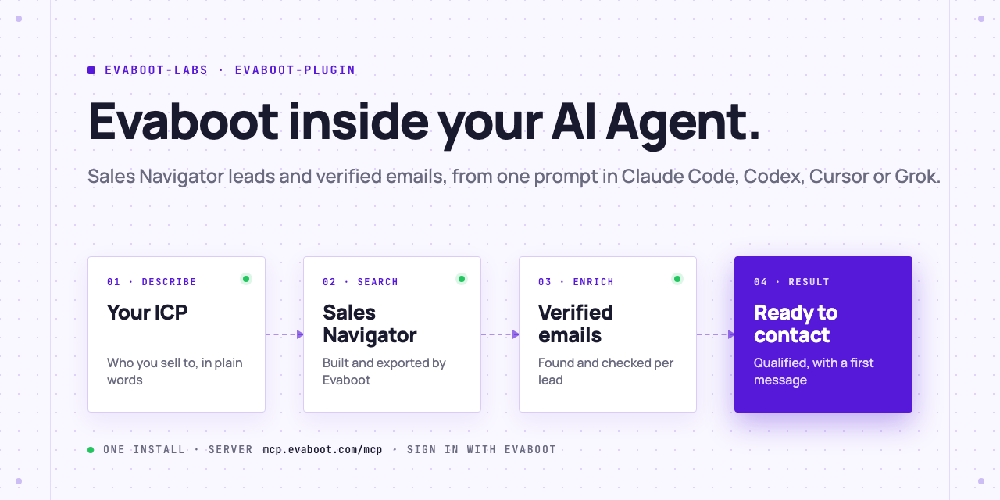
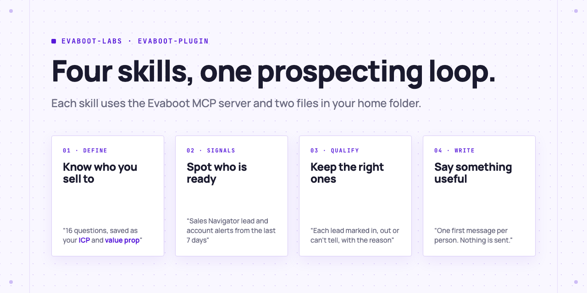

<picture>
  <source media="(prefers-color-scheme: dark)" srcset=".github/assets/banner-dark.png">
  
</picture>

# The Evaboot plugin

Evaboot inside your AI Agent: describe who you sell to, and get Sales Navigator leads with verified emails, qualified against your ICP, each with a first message ready to review.

[](AGENTS.md)
[](https://evaboot.com/mcp)
[](LICENSE)

## Set it up in one prompt

Paste this into Claude Code, Codex or Cursor:

```text
Install the Evaboot plugin from https://github.com/evaboot-labs/evaboot-plugin:
read its AGENTS.md and follow it. Connect the Evaboot MCP server, help me sign
in, then start by defining my ICP and value prop.
```

<details>
<summary>Or install it yourself</summary>

Claude Code:

```text
/plugin marketplace add evaboot-labs/evaboot-plugin
/plugin install evaboot-plugin@evaboot-labs-evaboot-plugin
```

Codex, Cursor and other agents:

```bash
npx skills add evaboot-labs/evaboot-plugin
```

Then connect the MCP server: [connect your agent](docs/connect-your-agent.md).

Grok Build: `grok plugin install https://github.com/evaboot-labs/evaboot-plugin.git`. Grok Bot and the Cursor Marketplace: search for **Evaboot**.

</details>

## Four skills, one prospecting loop

<picture>
  <source media="(prefers-color-scheme: dark)" srcset=".github/assets/skills-dark.png">
  
</picture>

Your ICP and value prop live in `~/.evaboot/`, so every later skill reuses them. Your agent can also call every [Evaboot MCP tool](https://github.com/evaboot-team/evaboot-mcp) directly: build a search from one sentence, export a list, find or verify an email, set up a recurring export. Nothing is sent to a prospect: you review every message.

## What you need

- **An Evaboot account:** [sign up](https://dash.evaboot.com/accounts/signup/?last_click_origin=evaboot-plugin-repo). You sign in once over OAuth; no API key to copy.
- **A LinkedIn Sales Navigator seat**, connected through the [Evaboot Chrome extension](https://dash.evaboot.com/install/).
- **Cost:** the plugin and the MCP server are free. Exports and email lookups use the credits in your Evaboot plan.

## Go further

| Page | For |
|---|---|
| [Connect your agent](docs/connect-your-agent.md) | The MCP setup by hand, per agent |
| [What the plugin runs and sends](docs/what-it-runs.md) | Security review: the server, the skills, the files they write |

---

Agents: start at [AGENTS.md](AGENTS.md) · Built by [Evaboot](https://evaboot.com) · More workflows at [github.com/evaboot-labs](https://github.com/evaboot-labs) · [MIT license](LICENSE)
